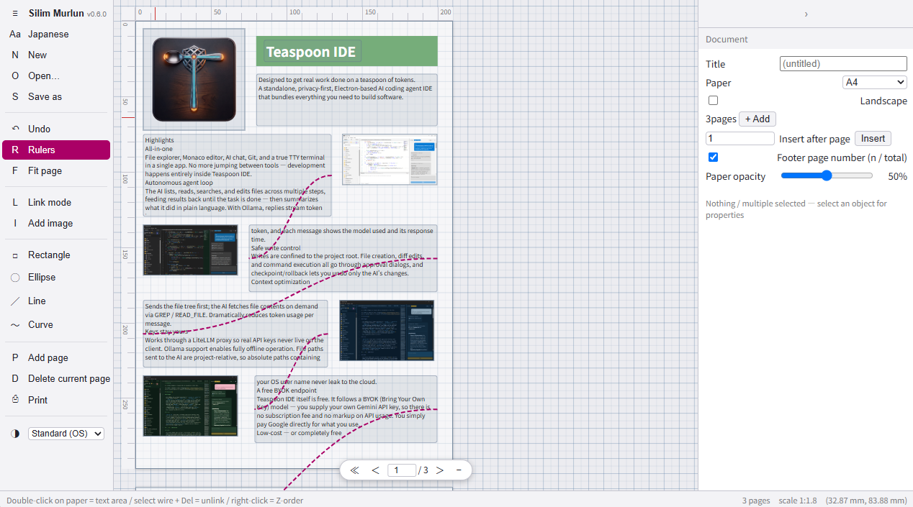

# Silim Murlun（シリム・ムールン）

日本語: [README.ja.md](README.ja.md)

A graph-paper layout editor for printed documents — true millimeter
units, linked text frames flowing across pages, and browser-native
printing.

> Place things at real size on graph paper, and let the text cross
> over wires between frames.



**[Live demo](https://cuculhart.github.io/silim-murlun/)** — runs in your browser, no install

See [CHANGELOG](CHANGELOG.md) for the release history (latest: v0.6.0).

## Features

- **True-size pages on a canvas** — A4/A3 portrait/landscape frames stacked vertically in world-millimeter coordinates; scrolling is page turning. Swapping paper size leaves object coordinates untouched
- **Linked text frames** — text flows tail → head through wire links across areas and pages. Overflow badges, chain edit pane, rollback unlink, mid-chain insertion
- **Shapes** — rectangle, ellipse, line, and click-vertex curve input (Enter/double-click to commit). Vertex grips, arrow/dot caps, dash styles, fill & stroke with alpha, border ON/OFF
- **Images** — file pick → true-size ghost → click to place; mm editing and aspect-ratio lock (live corner-drag constraint)
- **Multi-selection workflow** — Ctrl+D / Ctrl+C/V duplicate & copy-paste, grouping with click-through member editing, align & distribute
- **Text styling** — font, size, bold/italic/underline/color, and horizontal/vertical alignment on standalone areas
- **Undo / Redo** — unified snapshots of doc + chains + pages + settings (Ctrl+Z / Ctrl+Shift+Z / Ctrl+Y)
- **True-size printing** — in-app print preview plus the browser's own print dialog; dynamic `@page` and page-number footer
- **.slm archives** — zip format (doc.json + image binaries). Fully local — nothing is sent anywhere
- **UI in English & Japanese**, 4 themes, 5mm grid + 10mm majors with snapping (Alt disables)

## Getting started

```bash
git clone --recursive https://github.com/cuculhart/silim-murlun.git
# or after a plain clone: git submodule update --init

npm install
npm run dev       # http://localhost:5173
npm run build     # production build → app/dist/
npm run typecheck
npm test
```

React 19 + TypeScript + Vite + [Kimetron Isle](https://github.com/cuculhart/kimetron)
(vendored in `kimetron/` as a submodule) + [inimbal](inimbal/) text-flow
layer + fflate.

## Basic usage

| Goal | How |
|---|---|
| New text area | Double-click on the paper |
| Link areas | "Link mode" → click chain tail → another chain's head |
| Add a shape | Rect / ellipse / line / curve tool — curve places anchors per click (Enter or double-click commits) |
| Group / ungroup | Right-click a selection → Group / Ungroup |
| Duplicate | Ctrl+D or Ctrl+C/V — grids-step offset, keeps style |
| Align | Multi-select → Align & distribute in the inspector |
| Print | "Print" menu → preview → browser print |

## Name

`silim` is the Sumerian letter-opening word for well-being; `murlun`
is Welsh for mural — "a mural that greets". `inimbal`, the text-flow
layer, comes from `inim` (word) + `bal` (cross over).
